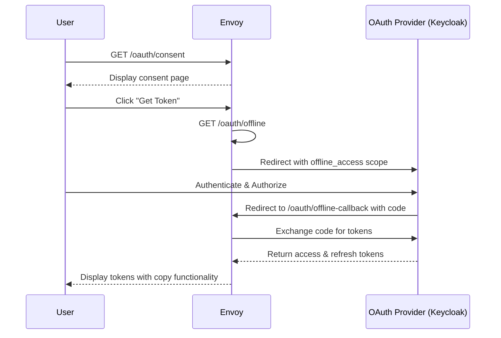

# Offline Token API Documentation

## Overview

The Offline Token API provides a secure way to obtain long-lived API keys for headless access without requiring browser-based authentication on every request. This feature is useful for:

- Automated scripts and CI/CD pipelines
- Command-line tools
- Background services
- API integrations

> **Where to find what:** This document covers the **issuance UX** — how a user obtains an offline token via the consent flow. The canonical **wire-format spec** for how clients send the token to the gateway lives in [`plugin/filter/llms.txt`](../plugin/filter/llms.txt) (also served live at `/oauth/llms.txt`). See §3.3 and §7.2 of that file for the protocol reference.

## Endpoints

These three endpoints implement the offline-token issuance flow. They are mounted by the filter and are only active when `enable_api_key: true` (see Configuration). The canonical endpoint reference is [`plugin/filter/llms.txt` §2](../plugin/filter/llms.txt).

| Endpoint | Method | Description |
|----------|--------|-------------|
| `/oauth/consent` | `GET` | Consent page explaining offline tokens and providing a "Get Token" button. |
| `/oauth/offline` | `GET` | Initiates the OAuth flow with `offline_access` scope to obtain a refresh token. |
| `/oauth/offline-callback` | `GET` | Handles the OAuth callback and displays the obtained tokens once. |

## Flow Sequence



## Configuration

### Enabling the Feature

The API key generation feature is disabled by default. To enable it, add the following to your Envoy configuration:

```yaml
typed_config:
  "@type": type.googleapis.com/envoy.extensions.filters.http.golang.v3.Config
  plugin_name: go-envoy-oauth
  plugin_config:
    "@type": type.googleapis.com/xds.type.v3.TypedStruct
    value:
      issuer_url: "https://your-oauth-provider/realms/your-realm"
      client_id: "your-client-id"
      client_secret: "your-client-secret"
      redirect_url: "/oauth/callback"
      enable_api_key: true  # Enable API key generation feature
```

When `enable_api_key: false` or omitted, the three endpoints above return `404`.

### OAuth Provider Setup (Keycloak Example)

1. **Enable `offline_access` scope** in your client configuration.
2. **Set Valid Redirect URIs** to include:
   - `https://your-domain/oauth/offline-callback`
   - `http://localhost:8081/oauth/offline-callback` (for local testing)

## Obtaining an Offline Token

1. Navigate to `https://your-domain/oauth/consent` in a browser.
2. Read the security information on the consent page.
3. Click **Get Offline Token**.
4. Authenticate with your OAuth provider.
5. Copy the displayed token. It is shown **once** — save it immediately.

## Using the API Key

**Send the token directly to the gateway on every request.** The gateway exchanges it for a short-lived access token internally (cached for the access token's lifetime); clients do not call the IdP's `/token` endpoint themselves.

Three acceptance methods, in order of preference:

```
api-key: <your-token>
```

```
x-api-key: <your-token>
```

```
GET /your-path?auth-api-key=<your-token>
```

Headers are strongly preferred — query parameters end up in proxy logs and `Referer` headers. Use the query form only when the client cannot set custom headers.

**Canonical reference:** [`plugin/filter/llms.txt`](../plugin/filter/llms.txt) §3.3 (Auth modes — Offline-token / API key) and §7.2 (Using the API key).

### Examples

```bash
# Header form (preferred)
curl -H "api-key: $API_KEY" https://your-gateway/api/resource

# Common variant
curl -H "x-api-key: $API_KEY" https://your-gateway/api/resource

# Query parameter (last resort)
curl "https://your-gateway/api/resource?auth-api-key=$API_KEY"
```

```python
import requests

API_KEY = "your-offline-token"

r = requests.get(
    "https://your-gateway/api/resource",
    headers={"api-key": API_KEY},
)
r.raise_for_status()
print(r.json())
```

## Security Considerations

1. **Secure Storage**: Store API keys securely:
   - Use encrypted storage for production environments.
   - Never commit tokens to version control.
   - Rotate tokens regularly.

2. **Token Lifetime**: Configure appropriate refresh-token lifetimes in your OAuth provider (e.g. 30–90 days). Consider implementing token rotation.

3. **Scope Limitations**: Only request necessary scopes for offline access.

4. **Revocation**: An API key is revoked by revoking the underlying offline session at the identity provider (e.g. via the provider's account-management UI).

5. **Audit Logging**: Monitor offline token usage for security purposes. The gateway redacts API-key query parameters from access logs (see `LogAccess` in `plugin/filter/logger.go`).

## Features

### Consent Screen
- Clear explanation of offline tokens
- Security warnings
- Modern, responsive UI
- One-click authorization

### Token Display Page
- Secure one-time display
- Copy to clipboard functionality
- Download as file option
- No-cache headers to prevent browser storage
- Separate display for refresh and access tokens

## Troubleshooting

### No Refresh Token Received

**Issue**: The token display page shows "Failed to obtain refresh token".

**Solutions**:
1. Verify `offline_access` scope is enabled in the OAuth provider.
2. Check the client configuration allows refresh tokens.
3. Ensure the redirect URL matches exactly.

### Invalid State Error

**Issue**: "Invalid or expired state parameter" error.

**Solution**: The OAuth flow timed out (5-minute limit). Start the process again from `/oauth/consent`.

### Token Copy Not Working

**Issue**: Copy button doesn't work.

**Solution**:
- Try the fallback method (select text manually).
- Use the "Download as File" option.
- Check browser permissions for clipboard access.

## Testing

### Local Testing with Docker Compose

1. Start the Envoy gateway:
   ```bash
   make start
   ```

2. Access the consent page:
   ```
   http://localhost:8081/oauth/consent
   ```

3. Follow the flow to obtain a token.

4. Use the token against a protected endpoint:
   ```bash
   curl -H "api-key: $TOKEN" http://localhost:8081/your-protected-path
   ```

## Implementation Details

The offline token feature is implemented in:

- **`plugin/oauth/offline_handler.go`** — Core logic for the offline token issuance flow.
- **`plugin/filter/apikey.go`** — Route handlers for the three `/oauth/*` endpoints; `extractAPIToken` defines the `api-key` / `x-api-key` / `?auth-api-key=` acceptance order.
- **`plugin/filter/filter.go`** — Filter integration and routing.
- **`plugin/oauth/handler.go`** — OAuth handler extensions used by the offline flow.

Key components:
- HTML templates for consent and token display pages
- State management for the OAuth flow
- Secure one-time token display (copy + download, no-cache headers)
